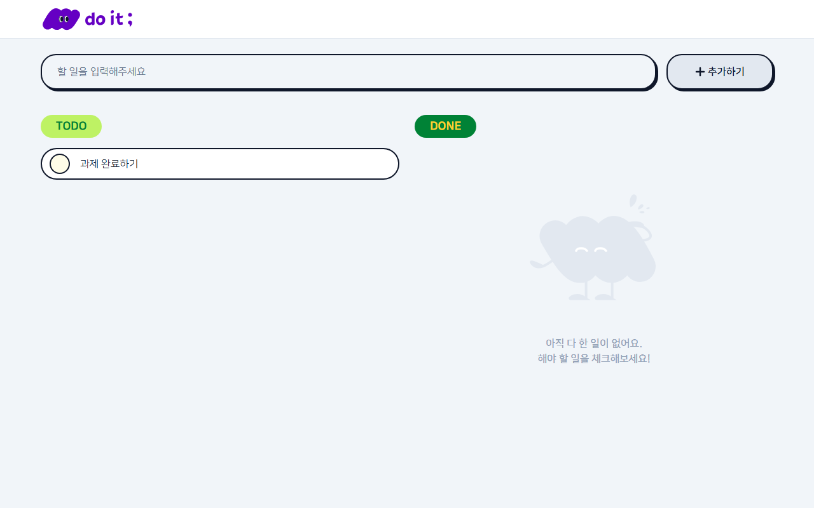
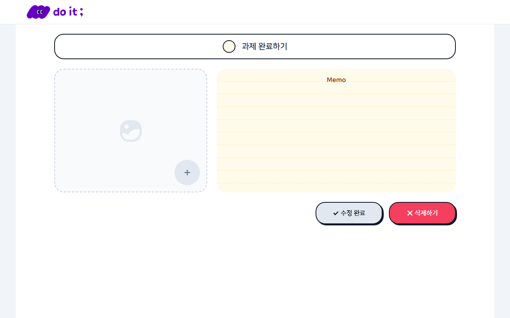
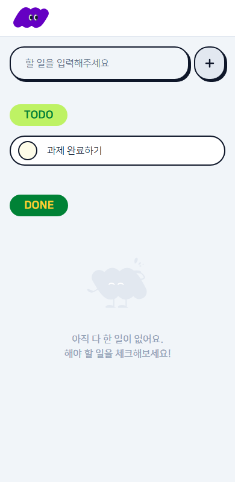
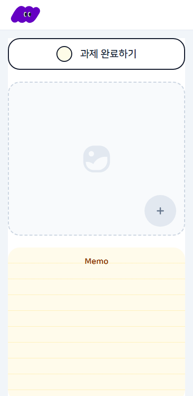

<div align="center">

# ✅ Todo List

**할 일을 추가하고, 완료하고, 상세하게 기록하는 심플한 To Do 서비스**


🔗 **배포 링크** : [https://todolist-codeit-five.vercel.app](https://todolist-codeit-five.vercel.app/)

</div>

---

## 📌 프로젝트 소개

진행 중인 할 일과 완료한 할 일을 한눈에 나눠 보고, 상세 페이지에서 이름·상태·메모·이미지를 관리할 수 있는 Todo 웹 서비스입니다.
모바일 · 태블릿 · 데스크탑 모두에서 자연스럽게 동작하는 반응형 UI로 만들었습니다.

## 🖼 스크린샷

| 목록 (데스크탑) | 상세 (데스크탑) |
| --- | --- |
|  |  |

| 목록 (모바일) | 상세 (모바일) |
| --- | --- |
|  |  |

## ✨ 주요 기능

### 📋 할 일 목록 (`/`)

| 기능 | 설명 |
| --- | --- |
| 목록 조회 | **TODO**(진행 중)와 **DONE**(완료)으로 구분해서 표시 |
| 할 일 추가 | 입력창에 내용을 쓰고 `추가하기` 버튼 클릭 또는 `Enter` |
| 완료 토글 | 항목 왼쪽 체크 버튼으로 진행 중 ↔ 완료 전환 |
| 로고 | 클릭하면 `/`로 이동(새로고침) |

### 📝 할 일 상세 (`/items/[itemId]`)

| 기능 | 설명 |
| --- | --- |
| 이름 수정 | 할 일 이름 변경 |
| 상태 수정 | 진행 중 / 완료 상태 변경 |
| 메모 | 메모 추가 및 수정 |
| 이미지 첨부 | 최대 1개, **파일명은 영문만**, **5MB 이하** |
| 수정 완료 | 변경 사항을 저장하고 목록으로 이동 |
| 삭제하기 | 할 일을 삭제하고 목록으로 이동 |

## 🛠 기술 스택

- **Framework** : Next.js 15 (App Router)
- **Language** : TypeScript
- **UI** : React 19, Tailwind CSS 4 (`@theme` 토큰 기반 컬러 시스템)
- **Test** : Playwright (E2E)
- **Lint** : ESLint

## 🚀 시작하기

### 1. 설치

```bash
npm install
```

### 2. 환경 변수 설정

프로젝트 루트에 `.env.local` 파일을 만들고 아래 값을 채웁니다.

```env
NEXT_PUBLIC_API_URL=https://assignment-todolist-api.vercel.app/api
NEXT_PUBLIC_TENANT_ID=본인만의_식별자
```

> `tenantId`는 닉네임이나 아이디처럼 본인을 구분할 수 있는 값으로 정하면 됩니다.
> API 문서(Swagger) : https://assignment-todolist-api.vercel.app/docs/

### 3. 실행

```bash
npm run dev
```

브라우저에서 [http://localhost:3000](http://localhost:3000)을 열어 확인합니다.

## 📜 스크립트

| 명령어 | 설명 |
| --- | --- |
| `npm run dev` | 개발 서버 실행 |
| `npm run build` | 프로덕션 빌드 |
| `npm start` | 프로덕션 서버 실행 |
| `npm run lint` | ESLint 검사 |
| `npm test` | Playwright E2E 테스트 |

> E2E 테스트를 처음 실행하기 전에 `npx playwright install chromium`을 한 번 실행해 주세요.

## 🧪 테스트

`e2e/checklist.spec.ts`는 평가 체크리스트([docs/[00] checklist.md](<docs/[00] checklist.md>))의 항목과 1:1로 대응합니다.
API 요청은 `page.route`로 모킹하므로 네트워크 없이도 실행되며, 개발 서버는 자동으로 띄워집니다.

## 📁 폴더 구조

```
codesprint
├─ docs/                  # 과제 요구사항 · 평가 체크리스트
├─ e2e/                   # Playwright E2E 테스트
└─ src/
   ├─ app/
   │  ├─ page.tsx         # 할 일 목록 페이지 (/)
   │  ├─ items/[itemId]/  # 할 일 상세 페이지
   │  ├─ layout.tsx
   │  └─ globals.css      # 컬러 시스템 (@theme 토큰)
   ├─ components/         # 공용 컴포넌트
   │  ├─ Header · Button · TextInput · CheckButton
   │  └─ TodoSection · TodoItem · ImageUpload · Icons
   ├─ lib/api.ts          # API 클라이언트
   └─ types/todo.ts       # Todo 타입 정의
```

## 🎨 설계 포인트

- **공용 컴포넌트** : Button, TextInput, CheckButton 등 반복되는 UI를 재사용 가능하게 분리
- **컬러 시스템** : `globals.css`의 `@theme`에 디자인 토큰으로 정의해 일관성 유지
- **반응형** : 모바일 / 태블릿 / 데스크탑 레이아웃 대응
- **API 클라이언트 분리** : 환경 변수 기반으로 `src/lib/api.ts`에서 일괄 관리
